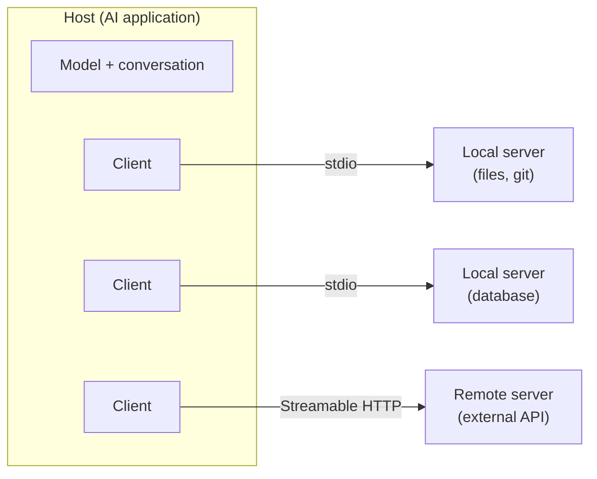
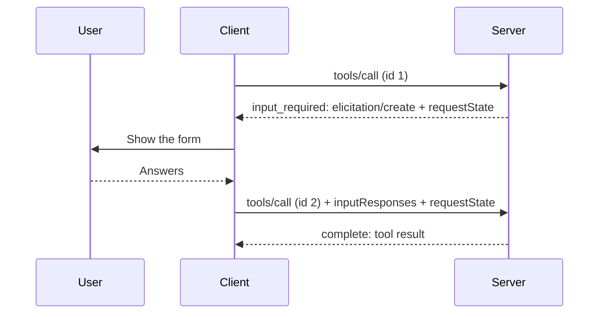

# MCP Overview

A technical overview of the Model Context Protocol, current to the [2026-07-28 specification](https://modelcontextprotocol.io/specification/2026-07-28). For how the protocol changed across revisions, see [Legacy vs. Modern MCP Servers](legacy-vs-modern.md).

## Contents

1. [What MCP is](#1-what-mcp-is)
2. [Hosts, clients, and servers](#2-hosts-clients-and-servers)
3. [Messages](#3-messages)
4. [Statelessness and discovery](#4-statelessness-and-discovery)
5. [What a server exposes](#5-what-a-server-exposes)
6. [Asking the client for input](#6-asking-the-client-for-input)
7. [Notifications, progress, and cancellation](#7-notifications-progress-and-cancellation)
8. [Transports](#8-transports)
9. [Authorization](#9-authorization)
10. [Extensions](#10-extensions)
11. [Security](#11-security)
12. [Legacy and modern MCP](#12-legacy-and-modern-mcp)

## 1. What MCP is

MCP is a JSON-RPC 2.0 protocol between an AI application and the programs that give it capabilities. A program implementing the server side exposes tools, resources, and prompts. The application connects, lists what the server offers, and puts those capabilities in front of a model or a user.

Before MCP, each AI application wrote its own integration with each service. With a shared protocol, a service implements one server and any compliant application can use it, and an application implements the client side once and can use any server. The specification compares this to the [Language Server Protocol](https://microsoft.github.io/language-server-protocol/), which did the same for editors and language tooling.

MCP defines the boundary between an application and a capability, and nothing on either side of it. It does not call the model, run the agent loop, decide which tool to use, or decide how results enter the model's context. Those are the application's decisions.

## 2. Hosts, clients, and servers

| Role | What it is | Responsibilities |
|:--|:--|:--|
| **Host** | The AI application: Claude, ChatGPT, VS Code, Cursor, an agent you wrote | Owns the conversation and the model. Decides which servers are connected, enforces user consent, and controls what context each server receives. |
| **Client** | A connector inside the host, one per server | Speaks the protocol to exactly one server. Attaches its protocol version and capabilities (the optional features it supports, such as showing the user a form) to every request. |
| **Server** | A program that exposes capabilities, running as a local subprocess or a remote HTTP service | Answers requests for its own tools, resources, and prompts. Knows nothing about other servers. |



The design keeps servers isolated. A server sees only what arrives in the requests sent to it. It never sees the full conversation and cannot see or call other servers. Any workflow that spans servers runs through the host, usually because the model calls one server's tool and then another's.

## 3. Messages

All traffic is [JSON-RPC 2.0](https://www.jsonrpc.org/specification), UTF-8 encoded. There are three message kinds:

- **Requests** carry a non-null `id`, a `method`, and `params`, and expect exactly one response.
- **Responses** carry the request's `id` and either a `result` or an `error`.
- **Notifications** carry a `method` and no `id`, and get no reply.

Only the client sends requests. The server answers each one and may send notifications tied to a request in flight or to an open subscription ([section 7](#7-notifications-progress-and-cancellation)). A `tools/call` request, which asks the server to run a tool, looks like this:

```json
{
  "jsonrpc": "2.0",
  "id": 7,
  "method": "tools/call",
  "params": {
    "name": "get_forecast",
    "arguments": { "latitude": 47.61, "longitude": -122.33 },
    "_meta": {
      "io.modelcontextprotocol/protocolVersion": "2026-07-28",
      "io.modelcontextprotocol/clientCapabilities": { "elicitation": { "form": {} } },
      "io.modelcontextprotocol/clientInfo": { "name": "example-host", "version": "3.2.0" }
    }
  }
}
```

`_meta` is an object for metadata about the request, separate from the method's own parameters. On every request the client includes the protocol version and its capabilities (both required) and should include its own name and version. A request missing a required field is rejected with `-32602 Invalid params`. Key prefixes whose second label is `modelcontextprotocol` or `mcp` are reserved for the protocol, and OpenTelemetry trace context (`traceparent`, `tracestate`, `baggage`) also travels in `_meta`.

Every result carries a `resultType`: `"complete"` for a normal result, or `"input_required"` when the server needs more from the client first (see [section 6](#6-asking-the-client-for-input)). Servers should include their name and version in each result's `_meta` under `io.modelcontextprotocol/serverInfo`.

Errors use the standard JSON-RPC codes (`-32700`, `-32600` to `-32603`) plus three MCP-defined codes:

| Code | Name | Meaning |
|:--|:--|:--|
| `-32020` | `HeaderMismatch` | An HTTP header disagrees with the request body, or a required header is missing |
| `-32021` | `MissingRequiredClientCapability` | The request needs a client capability the client did not declare |
| `-32022` | `UnsupportedProtocolVersion` | The server does not speak the requested version; `data.supported` lists the versions it does |

## 4. Statelessness and discovery

As of `2026-07-28`, MCP is stateless. There is no `initialize` handshake (the setup exchange earlier revisions used) and no session, and each request carries everything the server needs to process it. This has several consequences:

- **Any server instance can answer any request.** Plain load balancing and serverless deployments work, with no sticky sessions or shared session store.
- **A connection is not a conversation.** A client may interleave unrelated requests on one stdio process or HTTP connection, and the server must not infer context from earlier requests.
- **Lists don't vary per connection.** `tools/list` returns the same set to every caller with the same credentials. It may vary by authorization, for example by hiding tools a token's scopes don't permit.
- **Cross-call state is an explicit handle.** A server that needs continuity, such as a shopping cart or a browser context, returns an opaque identifier from one tool and accepts it as an argument on later calls. The handle's lifetime belongs in the creating tool's description, and an expired handle should produce a tool error that says so.

Servers must implement **`server/discover`**, which returns the protocol versions the server supports, its capabilities, its identity, and optional `instructions` (natural-language guidance for the model on using the server). Clients may call it first but don't have to. A client can send any request directly. If the server doesn't support the requested version, it answers with an `UnsupportedProtocolVersion` error listing the versions it does support, so the client can retry.

## 5. What a server exposes

A server offers up to three primitives. They differ in who decides when each is used.

| Primitive | Controlled by | Used for | Methods |
|:--|:--|:--|:--|
| **Tools** | The model | Actions and queries the model chooses to call | `tools/list`, `tools/call` |
| **Resources** | The application | URI-addressed data the host attaches as context | `resources/list`, `resources/templates/list`, `resources/read` |
| **Prompts** | The user | Message templates, usually surfaced as slash commands | `prompts/list`, `prompts/get` |

A server declares each primitive it supports as a capability (`tools`, `resources`, `prompts`) in its `server/discover` result. Tools do most of the work in practice, and host support for resources and prompts is less consistent, so check what your target hosts implement.

### Tools

A tool definition requires a `name` and an `inputSchema`. Everything else is optional: a display `title`, a `description` (optional in the schema, essential in practice), an `outputSchema`, `annotations`, and `icons`:

```json
{
  "name": "get_forecast",
  "title": "Weather Forecast",
  "description": "Get the 7-day forecast for a coordinate. Use search_locations first to resolve a place name.",
  "inputSchema": {
    "type": "object",
    "properties": {
      "latitude": { "type": "number", "minimum": -90, "maximum": 90 },
      "longitude": { "type": "number", "minimum": -180, "maximum": 180 }
    },
    "required": ["latitude", "longitude"]
  },
  "annotations": { "readOnlyHint": true, "openWorldHint": true }
}
```

- **Schemas** default to JSON Schema 2020-12, and any 2020-12 keyword is allowed. A tool with no parameters should use `{ "type": "object", "additionalProperties": false }`. Implementations must not fetch network `$ref`s by default.
- **Names** should be 1 to 128 characters from `A-Z a-z 0-9 _ - .`, unique within the server. Two servers can each expose a `search` tool, so a host aggregating servers has to disambiguate them.
- **Descriptions** are what the model reads when it decides whether and how to call the tool. They work like a prompt and need the same care.
- **Annotations** (`readOnlyHint`, `destructiveHint`, `idempotentHint`, `openWorldHint`) are hints for the host's consent UI. Clients must treat them as untrusted unless the server is trusted.
- **Ordering:** servers should return tools in a deterministic order so clients can cache the list and LLM prompt caches stay warm.

A tool result has two surfaces:

- **`content`**: an array of blocks for the model and the user: `text`, `image`, `audio`, `resource_link` (a URI the client can read), or an embedded `resource`. Each block can carry `audience` and `priority` annotations.
- **`structuredContent`**: any JSON value. If the tool declares an `outputSchema`, the server must return structured content that conforms to it, and clients should validate it. For compatibility, a tool returning structured content should also serialize it into a text block.

Failures come back in one of two ways:

| Kind | Returned as | Use for |
|:--|:--|:--|
| Protocol error | JSON-RPC `error` | Unknown tool, a request that doesn't match the `tools/call` schema, server faults |
| Tool execution error | A normal result with `isError: true` | Bad arguments, upstream API failures, business-rule violations: anything the model can correct and retry |

Clients should pass tool execution errors to the model, so the message should say what went wrong and what to try instead. Input validation failures belong in this category.

### Resources

A resource is data identified by a URI (`file:///project/README.md`, `postgres://db/schema/users`, or any scheme the server defines), returned as `text` or base64 `blob` with a `mimeType`. Servers publish concrete resources through `resources/list` and parameterized ones through `resources/templates/list` using [RFC 6570](https://datatracker.ietf.org/doc/html/rfc6570) URI templates (`weather://forecast/{city}`). Clients read them with `resources/read`. A missing resource returns `-32602`.

The host decides how resources reach the model. It might show a picker, search across them, or attach them automatically. Servers that support it advertise `subscribe` and `listChanged` and push updates over a subscription stream ([section 7](#7-notifications-progress-and-cancellation)).

### Prompts

A prompt is a named template with declared arguments. `prompts/get` fills the arguments and returns a list of messages, which may include text, images, and embedded resources. Hosts typically expose prompts as slash commands. Servers can offer argument autocompletion for prompts and resource templates through `completion/complete`.

## 6. Asking the client for input

Sometimes a server needs something from the client side in the middle of a request: a confirmation, a field the user didn't supply, a sign-in to a third-party service. Servers never send requests of their own. Instead they ask through **multi round-trip requests (MRTR)**, where the server answers the original request with a list of what it needs and the client retries with the answers:

1. The client sends a request (`tools/call`, `resources/read`, or `prompts/get`).
2. The server returns an `InputRequiredResult` (`resultType: "input_required"`) carrying a map of `inputRequests`, a `requestState`, or both. `requestState` is an opaque string only the server interprets; it lets the server resume without storing anything.
3. The client gathers the inputs, then retries the original request under a **new** JSON-RPC `id`, adding `inputResponses` and echoing `requestState` unchanged.
4. The server completes the request, or asks again if something is still missing.



The retry carries everything the server needs, so a different server instance can finish the request. Because `requestState` passes through the client, the server must treat it as attacker-controlled. If it affects authorization or business logic, the server must protect its integrity (HMAC or AEAD) and should bind it to the authenticated principal, a short expiry, and the originating request. A one-time operation also needs single-use enforcement on the server.

A server may only ask for inputs the client declared in its capabilities. If a request can't proceed without an undeclared one, the server returns `MissingRequiredClientCapability`. Three kinds of input request exist:

| Request | Purpose | Status |
|:--|:--|:--|
| `elicitation/create` | Ask the user. **Form mode** collects structured fields against a restricted JSON Schema. **URL mode** sends the user to a URL for interactions that must not pass through the client: credentials, sign-ins to third-party services, payments. Form mode must never ask for secrets, and a server must not use URL mode to authorize users to itself. | Active |
| `sampling/createMessage` | Ask the host's model for a completion | Deprecated in `2026-07-28`; call an LLM provider API directly |
| `roots/list` | Ask which directories are in scope | Deprecated in `2026-07-28`; take paths as tool parameters, resource URIs, or configuration |

## 7. Notifications, progress, and cancellation

| Mechanism | How it works |
|:--|:--|
| **Progress** | The client puts a `progressToken` in a request's `_meta`. The server sends `notifications/progress` on that request's response stream. |
| **Cancellation** | On stdio, the client sends `notifications/cancelled` with the request ID. On HTTP, closing the request's response stream is the cancellation. The server stops work and sends nothing further for that request. |
| **Change notifications** | The client opens a long-lived `subscriptions/listen` request with a filter (`toolsListChanged`, `promptsListChanged`, `resourcesListChanged`, `resourceSubscriptions: [uris]`). The server acknowledges with the subset it will honor, then sends matching notifications, each tagged in `_meta` with `io.modelcontextprotocol/subscriptionId` (the JSON-RPC ID of the listen request). If the stream drops, the client re-issues the request. |
| **Pagination** | List methods return an opaque `nextCursor`, which the client passes back as `cursor`. |
| **Caching** | Results from `server/discover`, the three list methods, `resources/templates/list`, and `resources/read` must carry `ttlMs` (how many milliseconds the client may treat the result as fresh) and `cacheScope` (`"public"` if any caller may share the cached copy, `"private"` if it may be reused only under the same authorization). Interim `input_required` results and MRTR retries are never cached. |
| **Logging** | `notifications/message` is sent only for requests whose `_meta` sets `io.modelcontextprotocol/logLevel`. The feature is deprecated: log to `stderr` on stdio and use OpenTelemetry for observability. |

## 8. Transports

Message semantics are identical on every transport. A transport defines only framing, where request metadata goes, and how cancellation and shutdown work.

### stdio

The host launches the server as a subprocess and exchanges newline-delimited JSON-RPC messages over its stdin and stdout.

- `stdout` carries MCP messages and nothing else. A stray `print` or `console.log` corrupts the stream, a common bug in local servers. Logs go to `stderr`.
- The client shuts down by closing stdin, and the server should exit when it reads end-of-file.
- Credentials come from the environment, not the authorization flow in [section 9](#9-authorization).
- The same framing works over any reliable byte stream (Unix sockets, TCP), and custom transports should reuse it.

### Streamable HTTP

The server exposes one endpoint (for example `https://example.com/mcp`) that accepts POST:

- Every client message is its own POST. The server responds with either a single JSON object or an SSE (Server-Sent Events) stream scoped to that request, which carries progress notifications and then the final response.
- Selected body fields are mirrored into headers so load balancers and gateways can route without parsing JSON: `MCP-Protocol-Version` and `Mcp-Method` on every request, plus `Mcp-Name` (the tool, prompt, or resource) on `tools/call`, `prompts/get`, and `resources/read`. A tool can mark a string, integer, or boolean parameter with `x-mcp-header` to have it sent as `Mcp-Param-{Name}`. Don't mark secrets or personal data this way, since intermediaries see headers. Servers reject any header that disagrees with the body using `-32020`.
- There are no sessions, no `Mcp-Session-Id`, no standalone GET stream, and no resumption via `Last-Event-ID`. If a stream breaks mid-request, the request is lost, and the client re-issues it with a new ID. Change notifications use `subscriptions/listen`, which is itself a POST.
- Servers must validate the `Origin` header (403 on mismatch) to block DNS rebinding, should bind to `127.0.0.1` when running locally, and should authenticate every request.

```http
POST /mcp HTTP/1.1
Content-Type: application/json
Accept: application/json, text/event-stream
MCP-Protocol-Version: 2026-07-28
Mcp-Method: tools/call
Mcp-Name: get_forecast
Authorization: Bearer eyJhbGciOi...
```

## 9. Authorization

Authorization applies to HTTP transports and is optional. A server that requires it follows a defined subset of OAuth:

1. **The MCP server is an OAuth 2.1 resource server.** It publishes [Protected Resource Metadata](https://datatracker.ietf.org/doc/html/rfc9728) (RFC 9728), which names its authorization server(s). An unauthenticated request gets `401`, typically with `WWW-Authenticate: Bearer resource_metadata="…", scope="…"`. A server that omits `resource_metadata` serves the metadata at `/.well-known/oauth-protected-resource`, and clients must check both.
2. **The client discovers the authorization server** through OAuth Authorization Server Metadata (RFC 8414) or OpenID Connect Discovery. Clients must support both.
3. **The client gets a client ID.** In order of preference: credentials pre-registered for this server; a [Client ID Metadata Document](https://datatracker.ietf.org/doc/html/draft-ietf-oauth-client-id-metadata-document-00), where the client ID is an HTTPS URL pointing to the client's metadata, if the authorization server advertises support; Dynamic Client Registration (RFC 7591), deprecated as of `2026-07-28`; and as a last resort, asking the user to enter client details.
4. **The client runs the authorization code flow with PKCE**, sending the `resource` parameter ([RFC 8707](https://www.rfc-editor.org/rfc/rfc8707.html)) so the token is bound to this server, and validating the `iss` parameter in the response ([RFC 9207](https://datatracker.ietf.org/doc/html/rfc9207)).
5. **The server validates every token's audience** and rejects tokens issued for anyone else. It must never forward the client's token to an upstream API. If it calls other services, it gets its own credentials for them.
6. **Step-up:** when a call needs more scope, the server returns `403` with `error="insufficient_scope"` and the required scopes, and the client re-authorizes for them.

Extensions cover other cases: OAuth client credentials for machine-to-machine access, and enterprise-managed authorization for organizations that control access centrally ([section 10](#10-extensions)).

## 10. Extensions

Extensions add optional functionality outside the core protocol. Each side lists the extensions it supports under `capabilities.extensions`, keyed by identifier. When only one side supports an extension, the side that supports it falls back to core behavior or rejects the request. Official extensions use the `io.modelcontextprotocol/` prefix and live in `ext-*` repositories under the [modelcontextprotocol](https://github.com/modelcontextprotocol) organization. Third-party extensions use a reversed domain the author owns (`com.example/feature`).

| Extension | What it adds |
|:--|:--|
| **Tasks** (`io.modelcontextprotocol/tasks`) | Long-running operations. A server returns a task handle instead of blocking, and the client polls `tasks/get` and sends mid-flight input with `tasks/update`. Moved out of the core protocol in `2026-07-28`. |
| **MCP Apps** (`io.modelcontextprotocol/ui`) | Interactive UI inside the conversation. A tool points to a `ui://` resource containing HTML, which the host renders in a sandboxed iframe that talks to the host over `postMessage`. |
| **[Skills](https://modelcontextprotocol.io/extensions/skills/overview)** (`io.modelcontextprotocol/skills`) | Servers publish Agent Skills (a `SKILL.md` plus supporting files) that clients discover and read through the Resources primitive. |
| **Authorization extensions** | OAuth client credentials and enterprise-managed authorization |

## 11. Security

The protocol has no way to enforce any of the following, so the work falls on hosts and servers.

- **Everything a server returns is untrusted input to the model.** Tool descriptions, annotations, results, and resource contents can all contain instructions planted by a malicious server or by whatever upstream data the server relays (prompt injection). Hosts should show the user which tools are available, ask before calling them, and display arguments before execution.
- **Data can leak across servers.** A model can read private data through one server and send it out through another. Only the host sees both sides, so only the host can stop this.
- **Local servers run with the user's privileges.** Installing one means running someone else's code.
- **Confused deputy and token passthrough.** A server must accept only tokens issued for itself and must never relay a client's token upstream. A server that proxies to a third-party authorization server under a static client ID must get the user's consent for each dynamically registered client before forwarding it there.
- **SSRF.** Clients fetch OAuth metadata URLs a server supplies, and authorization servers fetch client metadata documents. Both should block private, loopback, and link-local addresses, as should any implementation that opts in to fetching remote schema `$ref`s.
- **DNS rebinding.** Local HTTP servers validate `Origin` and bind to localhost.
- **MRTR state.** `requestState` is client-controlled, so sign or encrypt it as described in [section 6](#6-asking-the-client-for-input).

The specification's [security best practices](https://modelcontextprotocol.io/docs/2026-07-28/tutorials/security/security_best_practices) cover each attack and its mitigations.

## 12. Legacy and modern MCP

Revision `2026-07-28` split MCP into two eras. The specification calls handshake-based revisions (`2025-11-25` and earlier) **legacy**, the per-request revisions **modern**, and implementations that speak both **dual-era**.

| | Legacy (≤ `2025-11-25`) | Modern (`2026-07-28`) |
|:--|:--|:--|
| Setup | `initialize` handshake negotiates version and capabilities once | No handshake; every request carries version and capabilities in `_meta` |
| State | Protocol-level session (`Mcp-Session-Id` on HTTP) | Stateless; continuity comes from explicit handles |
| Server needs input | Server sends its own requests (`sampling/createMessage`, `elicitation/create`, `roots/list`) | Server returns `InputRequiredResult`; client retries (MRTR) |
| Change notifications | HTTP GET stream, `resources/subscribe` | `subscriptions/listen` |
| HTTP stream recovery | Resumable via `Last-Event-ID` | Not resumable; re-issue the request |
| Discovery | Implicit in `initialize` | `server/discover` |

A modern-only client can't talk to a legacy server, and a legacy client can't talk to a modern-only server. Servers therefore need to stay dual-era until their clients have upgraded. The TypeScript SDK implements the modern revision in its v2 packages (`@modelcontextprotocol/server`, `@modelcontextprotocol/client`), which replace the single v1 package `@modelcontextprotocol/sdk` and still serve legacy clients by default.

**[Legacy vs. modern servers](legacy-vs-modern.md)** covers the full revision history, the compatibility matrix, how clients detect a server's era, deprecation timelines, and a migration checklist for server authors.

